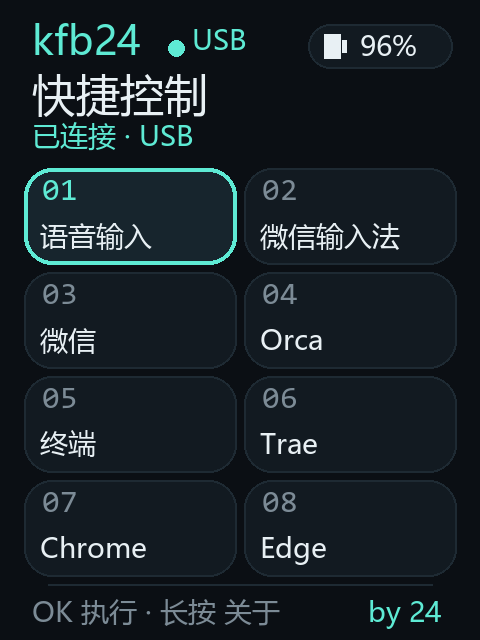

# kfb24

**kfb24** 是运行在 [FoloToy AI Passport](https://ai-passport.folotoy.cn/) 上的
Windows 快捷控制台。三颗实体按键、一块 240×320 屏幕，通过 USB、Wi-Fi 或 BLE 连接
电脑，把常用操作变成无需键盘的单击动作。

它不是上游的硬件测试菜单：kfb24 有自己的界面、按键状态机和 PC 桥接协议。

<p align="center">
  
</p>

<p align="center">
  
</p>

<p align="center"><sub>kfb24 主界面预览（按 240×320 的实际卡片布局生成，不是设备照片）</sub></p>

## 功能

- **八个动作**：语音输入、微信输入法、微信、Orca、终端、Trae、Chrome、Edge。
- **微信输入法语音输入**：电脑端发送微信输入法的语音快捷键（默认 `Ctrl+Win`），
  不再使用 Windows `Win+H`；识别出的文字进入当前焦点输入框。
- **聚焦已有窗口**：微信、Orca、终端、Trae、Chrome、Edge 已打开时直接恢复并置于
  前台，不重复启动进程；微信不会出现第二个实例。
- **三种连接**：USB 串口、Wi-Fi TCP、BLE（Nordic UART Service）。
- **断线可恢复**：PC 桥接每两秒发送心跳；BLE 断开后自动重连；开发板显示当前
  通道和桥接状态。
- **离线可用**：动作全部在本机执行，不依赖云服务；Wi-Fi 仅用于开发板与电脑通信。

## 硬件

| 项目 | 参数 |
| --- | --- |
| MCU | ESP32-C3，8 MB Flash，无 PSRAM |
| 显示 | ST7789P3，240×320，4-line SPI |
| 按键 | 三键共用一个 ADC 引脚，分压识别上/下/确定 |
| 音频 | ES8311 codec，I2S 全双工（kfb24 的语音使用电脑麦克风） |
| 电量 | CW2017 电量计 |
| 固件 | ESP-IDF 5.5.x |

引脚和硬件事实以
[`components/bsp/include/bsp_pins.h`](components/bsp/include/bsp_pins.h) 为准。

## 快速开始

### 1. 一键启动并登录自启（推荐）

双击 `pc\install_autostart.cmd`。它会：

- 查找 Python 3.9+，缺少 `pyserial` / `bleak` 时自动安装；
- 在 Windows 启动目录创建 `kfb24 Bridge` 快捷方式，并立即在后台启动桥接；
- 把输出写入 `%LOCALAPPDATA%\kfb24\bridge.log`。

以后登录 Windows 会自动启动，不需要打开终端。若只想本次启动，双击
`pc\start_bridge.cmd`；取消自启并停止桥接，双击 `pc\uninstall_autostart.cmd`。

启动日志应出现 `serial: COMx @ 115200`（或 `ble: connected`）以及
`bridge: ready ...`。开发板显示“已连接”后即可按键。

### 2. 手动准备与启动

Windows 10/11，Python 3.9 或更新版本：

```powershell
python -m pip install -r pc/requirements.txt
```

安装微信输入法，并在其设置中把语音输入快捷键设为 `Ctrl+Win`（或与
`voice_hotkey` 相同的组合）。

```powershell
python pc/kfb24_bridge.py --port COM6 --ble
```

- `--port` 省略时自动查找 Espressif USB 串口。
- `--ble` 需要 `bleak`，让桥接同时作为 BLE central 连接广播名 `kfb24` 的开发板。
- 默认 TCP 端口 `8765`；只应在可信局域网运行。
- `--dry-run` 只打印动作，不发送输入或启动程序。

如果串口被串口监视器、另一个桥接或 IDE 占用，新版桥接会打印
`serial: COMx unavailable ... continuing with BLE/TCP` 并继续工作，不再直接退出。
同一时间只允许一个桥接实例；重复启动会提示
`another kfb24 bridge is already running`。

### 3. 可选：通过 USB 配置 Wi-Fi

配置前先停止自动启动的桥接，否则它占用 COM 口：

```powershell
pc\uninstall_autostart.cmd
python pc/kfb24_bridge.py --list-ports
python pc/kfb24_bridge.py --configure --ssid "MyWifi" --password "secret"
```

配置完成后再次双击 `pc\install_autostart.cmd` 恢复自启。不配置 Wi-Fi 也可以只用
USB 或 BLE。

### 4. 操作开发板

- **上 / 下**：选择动作。
- **确定短按**：执行当前动作。
- **确定长按**：打开“关于”，显示连接、BLE、网络、地址、电量和固件版本；再按确定
  关闭。

## 动作

| 界面 | 命令 | 电脑端行为 |
| --- | --- | --- |
| 语音输入 | `voice` | 发送微信输入法语音快捷键，默认 `Ctrl+Win` |
| 微信输入法 | `ime` | 激活 WeType TSF 配置，失败时发送 `ime_hotkey` |
| 微信 | `wechat` | 聚焦已有微信窗口，否则启动 `Weixin.exe` |
| Orca | `orca` | 聚焦已有 Orca，否则启动 `Orca.exe` |
| 终端 | `terminal` | 聚焦 Windows Terminal，否则启动 `wt.exe` |
| Trae | `trae` | 聚焦已有 Trae，否则启动 `Trae.exe` |
| Chrome | `chrome` | 聚焦已有 Chrome，否则启动 `chrome.exe` |
| Edge | `edge` | 聚焦已有 Edge，否则启动 `msedge.exe` |

`voice` 只负责启动语音输入；请先把光标放到目标输入框。桥接不会把音频从开发板
推流到电脑。

## 连接与协议

开发板与 PC 桥接使用同一套行协议：

```text
KFB24 CMD <action> <id>
KFB24 ACK <id> OK|ERR
KFB24 HELLO bridge/<version>
KFB24 STATE <transport> <up|down> <detail>
```

- **USB**：ESP32-C3 USB-Serial-JTAG，VID:PID `303A:1001`，115200。
- **Wi-Fi**：开发板作为 TCP 客户端连接电脑的 `8765` 端口；桥接地址和端口在
  `--configure` 时写入 NVS。
- **BLE**：开发板广播 `kfb24`，使用 Nordic UART Service：
  - Service `6E400001-B5A3-F393-E0A9-E50E24DCCA9E`
  - RX（PC → 板）`6E400002-…`
  - TX（板 → PC）`6E400003-…`
  - 使用由芯片 MAC 派生的稳定随机静态地址，避免与同一芯片上旧固件的
    BLE 身份或 Windows 缓存冲突；客户端按名称 `kfb24` 扫描即可。

USB 同时可用时优先走 USB；USB 不可用且 BLE 是当前桥接通道时走 BLE；否则走
Wi-Fi/TCP。

## 配置

电脑端读取 `%APPDATA%\kfb24\bridge.json`，所有键都可选。常用覆盖项：

```json
{
  "voice_hotkey": "ctrl+win",
  "trae": "C:\\Users\\me\\AppData\\Local\\Programs\\Trae\\Trae.exe",
  "chrome": "C:\\Program Files\\Google\\Chrome\\Application\\chrome.exe",
  "edge": "C:\\Program Files (x86)\\Microsoft\\Edge\\Application\\msedge.exe"
}
```

`voice_hotkey` 设为 `right-alt` 时桥接按住右 Alt 1.2 秒；设为空字符串禁用语音动作。
程序路径和输入法配置的完整说明见 [`pc/README.md`](pc/README.md)。

## 构建与验证

需要已激活的 ESP-IDF 5.5.x 环境：

```bash
./tools/validate.sh --static
./tools/validate.sh --firmware
```

单独构建：

```bash
idf.py -B build-kfb24 build
```

静态检查包括仓库规则、字体字形覆盖和主机端测试；固件构建会生成合并镜像。构建成功
不等于真机验证，刷写前请先确认设备连接并获得操作者同意。

## 目录

| 路径 | 内容 |
| --- | --- |
| `main/kfb24_ui.c` | kfb24 界面、八卡片布局、按键交互、关于页 |
| `main/kfb24_link.c` | USB/Wi-Fi/BLE 链路、心跳、命令与 ACK |
| `main/kfb24_ble.c` | NimBLE NUS 外设 |
| `main/kfb24_config.c` | NVS 配置 |
| `main/kfb24_power.c` | 电量与电源状态 |
| `pc/kfb24_bridge.py` | Windows 桥接：输入、启动器、BLE central |
| `pc/start_bridge.cmd` | 双击启动桥接；`install_autostart.cmd` 创建登录自启 |
| `components/bsp/` | 显示、按键、音频、I2C 等板级支持 |

## 注意

- 局域网 TCP 监听会接受同网段命令，只在可信网络运行。
- BLE NUS 通道没有应用层认证；附近任何能连接 `kfb24` 的 BLE 客户端都能发送控制
  命令，只在可信环境启用 `--ble`。
- 仓库不保存 Wi-Fi 密码、令牌或私钥；开发板把 Wi-Fi 配置存放在 NVS。
- 界面中文使用 `main/fonts/` 中的 kfb24 字体子集。新增中文文案前必须确认字形覆盖，
  必要时重新生成字体。
- 本项目基于 FoloToy AI Passport 的 BSP 与工具链，但拥有独立的应用界面与交互，不复用
  上游测试菜单。

## 许可

MIT，详见 [`LICENSE`](LICENSE)。
